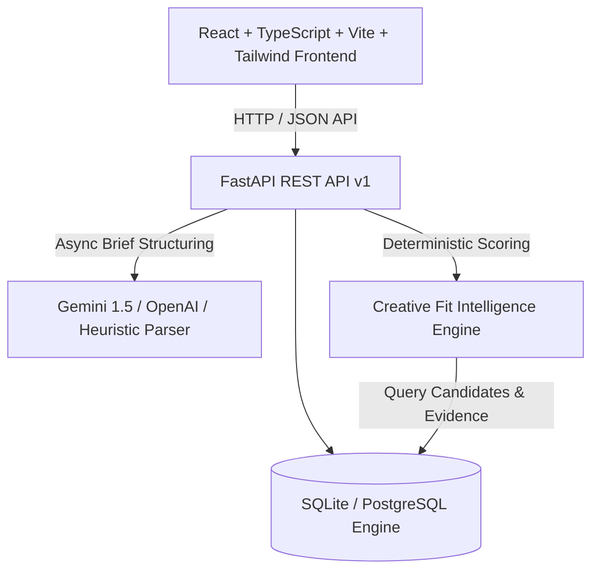

# UNFRAME — Technical Architecture & Implementation Plan

## 1. System Architecture


## 2. Directory Structure
```
hacXLerate/
├── backend/
│   ├── app/
│   │   ├── api/             # API v1 routes (creators, briefs, matches, engagements, shortlist)
│   │   ├── core/            # Config, settings, database session
│   │   ├── models/          # SQLAlchemy ORM models
│   │   ├── schemas/         # Pydantic schemas (request/response)
│   │   ├── services/        # Matching engine, brief structurer, seed generator
│   │   └── main.py          # FastAPI application entrypoint & CORS
│   ├── requirements.txt
│   └── .env.example
├── frontend/
│   ├── src/
│   │   ├── components/      # Layout, UI tokens, Creators, Briefs, Matching, Engagements
│   │   ├── pages/           # 8 connected application views
│   │   ├── services/api.ts  # Typed HTTP client
│   │   ├── types/index.ts   # Core domain interfaces
│   │   └── App.tsx          # React Router v6 routing & global state
│   ├── package.json
│   ├── tailwind.config.js
│   └── vite.config.ts
```

## 3. Implementation Checklist & Phases
- [x] **Phase 0:** Inspect repo, define PRD and ARCHITECTURE.
- [ ] **Phase 1:** Backend foundation: FastAPI, SQLite/SQLAlchemy schemas, seed data (12 realistic creators with full workflows and portfolio evidence).
- [ ] **Phase 2:** Creative Fit Intelligence matching engine & AI brief structurer API.
- [ ] **Phase 3:** Frontend setup: Vite, React 18/19, Tailwind CSS, Lucide icons, Design tokens (Warm white / charcoal / electric violet).
- [ ] **Phase 4:** Brand Discovery, Homepage, & Navigation Shell.
- [ ] **Phase 5:** AI Creative Brief Builder (Raw idea -> Structured draft -> Confirmation).
- [ ] **Phase 6:** Explainable Creator Search, Multi-factor Filtering & Matching Results.
- [ ] **Phase 7:** Creator Profile, Portfolio detail, Workflow Recipes & Evidence Verification.
- [ ] **Phase 8:** Creator Studio (profile & project editing), Shortlist, and End-to-End Engagement/Delivery Lifecycle.
- [ ] **Phase 9:** Verification, QA, E2E browser validation, and Demo Walkthrough rehearsal.
